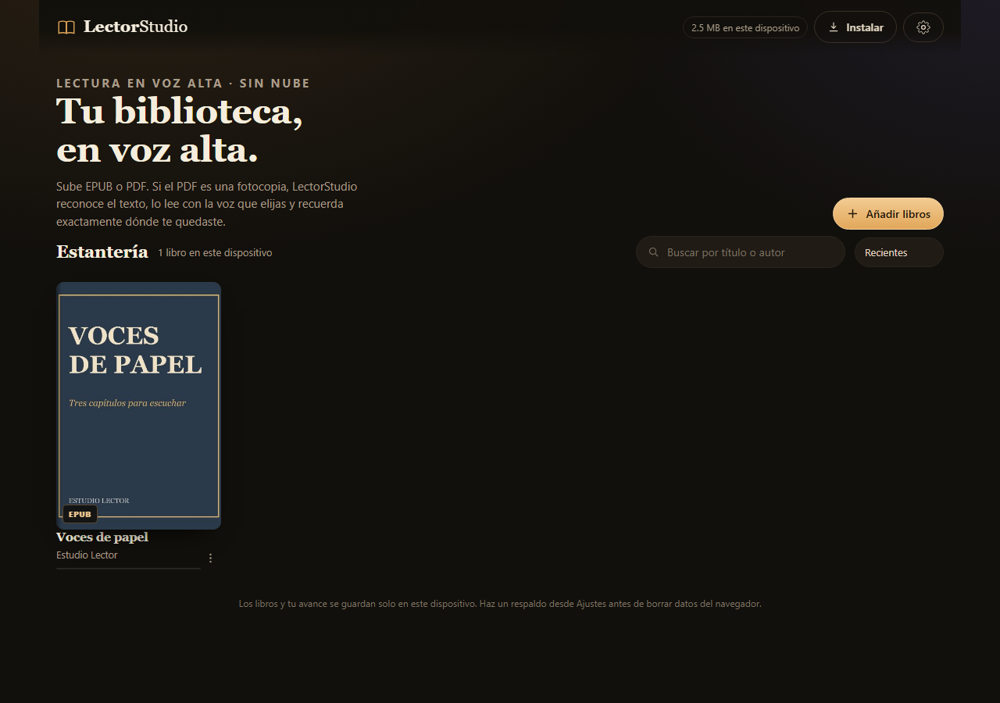
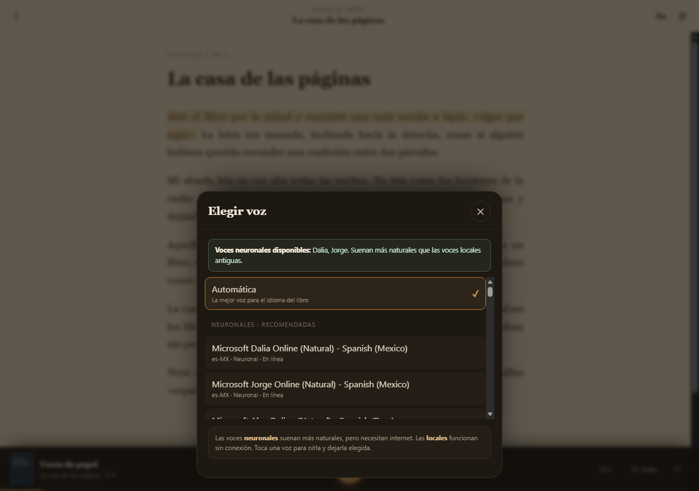

# LectorStudio

Biblioteca personal de **EPUB y PDF** que **lee en voz alta** con las voces del dispositivo, **reconoce el texto de las fotocopias** (OCR local) y **guarda tu marcador** exactamente donde lo dejaste. La biblioteca, el texto y tu avance viven en el dispositivo: no hay cuentas ni servidores propios. Las voces neuronales opcionales usan el servicio del navegador, como se explica más abajo.

Funciona como **aplicación web instalable (PWA)** en **PC, Android y iOS** con el mismo código. No requiere App Store ni Play Store.



---

## Lo que hace

- **Sube EPUB o PDF** arrastrando los archivos o con el botón *Añadir libros*.
- **PDF escaneado = fotocopia**: detecta las páginas sin capa de texto y las pasa por **Tesseract OCR** dentro del navegador (español e inglés). Reconoce acentos, comillas y párrafos.
- **Lee en voz alta** con cualquier voz instalada en el sistema y **prioriza las neuronales** cuando el navegador las ofrece (Edge en Windows trae Dalia y Jorge). Ajusta velocidad, tono y volumen; resalta la frase que suena, hace pausas entre párrafos y desplaza la página sola.
- **Guarda la biblioteca en el propio dispositivo** (IndexedDB). Cada equipo tiene su copia; no se sincroniza sola.
- **Marcador por libro**: guarda capítulo y frase. Al volver, retoma en el punto exacto y lo muestra en la tarjeta («Continuar leyendo», % de avance).
- **Dos vistas para PDF**: la página escaneada original (con el texto resaltado encima) o el texto reconocido, reflowado para pantalla pequeña.
- **Índice con progreso**, búsqueda, orden por reciente/título/avance y modo claro, sepia u oscuro.
- **Funciona sin conexión** una vez instalada (la app y los libros quedan en el dispositivo).
- **Respaldo completo** en un ZIP: libros originales, texto reconocido, portadas y marcadores.

## Arranque rápido en la PC

Requiere **Python 3.10 o superior** (solo para servir los archivos; la app no usa Python).

1. Doble clic en **`LectorStudio.bat`** (en la raíz del workspace). Abre la app en **Microsoft Edge** si está disponible, porque expone las voces neuronales **Dalia** y **Jorge** (español de México).
2. Se abre `http://127.0.0.1:8840/`.
3. Arrastra un EPUB o un PDF, o pulsa **Añadir libros**.

> Si prefieres Chrome, abre la misma dirección en Chrome; la app funciona igual, pero solo verá las voces locales SAPI y te mostrará un aviso. También puedes usar **`LectorStudio-Edge.bat`** de forma explícita.

También puedes arrancarlo desde el panel general **`Servidores.bat`**.

Para probar sin tener un libro a mano, la pantalla inicial incluye **«Libro de ejemplo»** y **«Probar una fotocopia»** (un PDF escaneado real, con manchas y ligera inclinación).

### Abrir desde el celular en la misma red

1. Doble clic en **`LectorStudio-Red.bat`**.
2. La ventana muestra una dirección tipo `http://192.168.1.50:8840/`.
3. Ábrela en el navegador del teléfono (misma wifi).

> En `http://` por red local la app funciona, pero **no se puede instalar** ni conservar el modo sin conexión: los navegadores exigen HTTPS para el service worker. Para instalarla de verdad en Android/iOS, publica la carpeta en cualquier hosting estático con HTTPS (ver `docs/guia-uso.md`).

## Instalación en Android, iPhone y iPad

La app es 100 % estática: súbela a **Netlify Drop**, **Cloudflare Pages**, **GitHub Pages** o similar y ábrela por HTTPS.

- **Android (Chrome)**: menú `⋮` → *Instalar aplicación* / *Añadir a pantalla de inicio*.
- **iPhone/iPad (Safari)**: botón **Compartir** → *Añadir a pantalla de inicio*. Ábrela desde el icono: así Safari no borra los libros por falta de uso.
- **PC (Chrome/Edge)**: icono de instalar en la barra de direcciones.

Guía paso a paso: **[docs/guia-uso.md](docs/guia-uso.md)**.

## Voz

Usa la **Web Speech API**: las voces que ya tiene el sistema (SAPI en Windows, Google TTS en Android, voces de Siri/Apple en iOS). No hay voces pregrabadas ni servicios de pago.

- **En Windows**, Chrome solo expone las voces locales SAPI (Raul/Sabina), que suenan robóticas. **Microsoft Edge expone voces neuronales** —Dalia, Jorge, Elvira…— y la app las prioriza: para un libro en `es-MX` elige **Dalia** automáticamente. Por eso existe **`LectorStudio-Edge.bat`**.
- La app ordena las voces por calidad y las etiqueta: **Neuronal**, **Local** o **En línea**. También muestra una recomendación si detecta que solo hay voces locales.
- Puedes elegir otra voz, velocidad (0,8×–2×), tono y volumen. La hoja de voces reproduce una muestra al tocarlas.
- Hace una **pausa breve entre párrafos** para que la lectura no suene atropellada.
- Las voces neuronales necesitan internet; sin conexión la app usa una voz local automáticamente.
- En iOS, la primera reproducción debe hacerse con un toque (la app lo hace así). Las voces *Premium* se descargan en *Ajustes → Accesibilidad → Contenido leído → Voces*.
- En Android, las voces de Google TTS se eligen en *Ajustes → Accesibilidad → Texto a voz*.



### iOS y Android

La misma app funciona en los dos como PWA instalable (ver [instalación](#instalación-en-android-iphone-y-ipad)). Las voces son las del sistema, no las de Edge de escritorio:

- **iPhone/iPad (Safari)**: descarga una voz **Premium** o **Mejorada** en *Ajustes → Accesibilidad → Contenido leído → Voces → Español*. La app prioriza las voces Siri/mejoradas que Safari exponga. Safari no siempre muestra todas las voces de Siri a las webs; si no aparecen, usa Mónica/Paulina.
- **Android (Chrome)**: instala **Google TTS** y descarga la voz de español en *Ajustes → Accesibilidad → Texto a voz*. La app prioriza Google TTS y, para un libro `es-MX`, elige el español de EE. UU. antes que el de España. Necesita internet; sin conexión cae a una voz local.
- **Dalia y Jorge son de Edge en Windows**: los navegadores móviles no exponen esas voces neuronales de escritorio. Para tenerlas en el teléfono habría que añadir un modo de voz por servidor (edge-tts en la PC por wifi, o un backend en la nube); no viene incluido para no romper el funcionamiento local/offline.

## Privacidad y datos

- Los libros, el texto reconocido y los marcadores se guardan **solo** en el almacenamiento del navegador de ese dispositivo.
- El OCR corre en el propio equipo con WebAssembly; **ningún archivo se sube a internet**.
- Las **voces locales** no salen del equipo. Las **voces neuronales en línea** (por ejemplo Dalia en Edge o las de Google) envían a su proveedor únicamente el texto que se está leyendo para generar el audio. Si quieres privacidad total, elige una voz **Local** en la hoja de voces.
- Al publicar la app solo se descarga el código (y los modelos de OCR la primera vez que se usa una fotocopia).
- Borrar los datos del navegador borra la biblioteca. Usa **Ajustes → Exportar respaldo** para conservarla o moverla.

## Estructura

```
lector-studio/
  index.html            interfaz y carga de librerías locales
  css/app.css           estilos (biblioteca, lector, hojas, móvil)
  js/app.js             arranque, rutas, importación, respaldos
  js/db.js              IndexedDB: libros, contenido, archivos, imágenes, marcadores
  js/epub.js            lectura del EPUB (OPF, spine, índice, texto e imágenes)
  js/pdfdoc.js          PDF.js, extracción de texto, OCR y render de páginas
  js/import.js          pipeline de importación EPUB/PDF y re-OCR
  js/text.js            frases, trozos de voz y cajas de texto
  js/reader.js          lector: render, resaltado, reproducción, marcador
  js/speech.js          Web Speech API y selección de voces
  js/library.js         estantería y tarjeta «Continuar»
  js/sheets.js          ajustes, voces, índice, menú de libro, instalación
  js/backup.js          respaldo ZIP completo
  js/prefs.js           preferencias del dispositivo
  sw.js                 service worker (offline)
  manifest.webmanifest  manifiesto PWA
  vendor/               PDF.js, Tesseract.js, JSZip y modelos de idioma (sin CDN)
  samples/              libros de ejemplo para probar
  server.py             servidor local (solo entrega archivos)
  start.bat             lanzador de la PC
```

Detalles técnicos y decisiones: **[docs/arquitectura.md](docs/arquitectura.md)**.

## Requisitos

- Navegador moderno: Chrome/Edge 105+, Safari 16.4+ (iOS 16.4+), Firefox 115+.
- Para las voces neuronales en Windows, **Microsoft Edge** (incluido en Windows 10/11). Chrome solo usa las voces SAPI locales.
- Para el OCR, la primera vez se cargan ~8 MB de datos de idioma por idioma (quedan en caché); si eliges español + inglés, unos 19 MB.
- Los EPUB con DRM no se pueden abrir.
- Límite de archivo por libro: 350 MB.
- El OCR tarda unos segundos por página; en un libro escaneado largo conviene dejarlo con el dispositivo cargando.

## Estado

Versión 1.0.0 · noviembre 2026.

Probado de punta a punta con Chrome 156 y Edge 157 (escritorio y viewport móvil): importación de EPUB con portada e imágenes, PDF con texto, PDF escaneado con OCR en español, guardado y restauración del marcador tras recargar, respaldo ZIP, lectura en voz alta con avance automático, selección automática de la voz neuronal **Dalia** en Edge, y funcionamiento sin conexión. Ver `docs/pruebas.md`.

## Licencia y créditos

Código propio del workspace. Librerías de terceros en `vendor/`, con sus licencias originales:

- [PDF.js](https://mozilla.github.io/pdf.js/) (Apache 2.0)
- [Tesseract.js](https://tesseract.projectnaptha.com/) (Apache 2.0) y modelos de [tessdata](https://github.com/tesseract-ocr/tessdata) (Apache 2.0)
- [JSZip](https://stuk.github.io/jszip/) (MIT)
